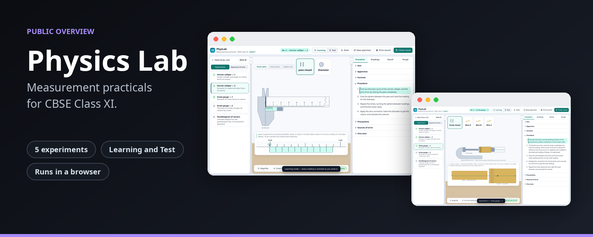
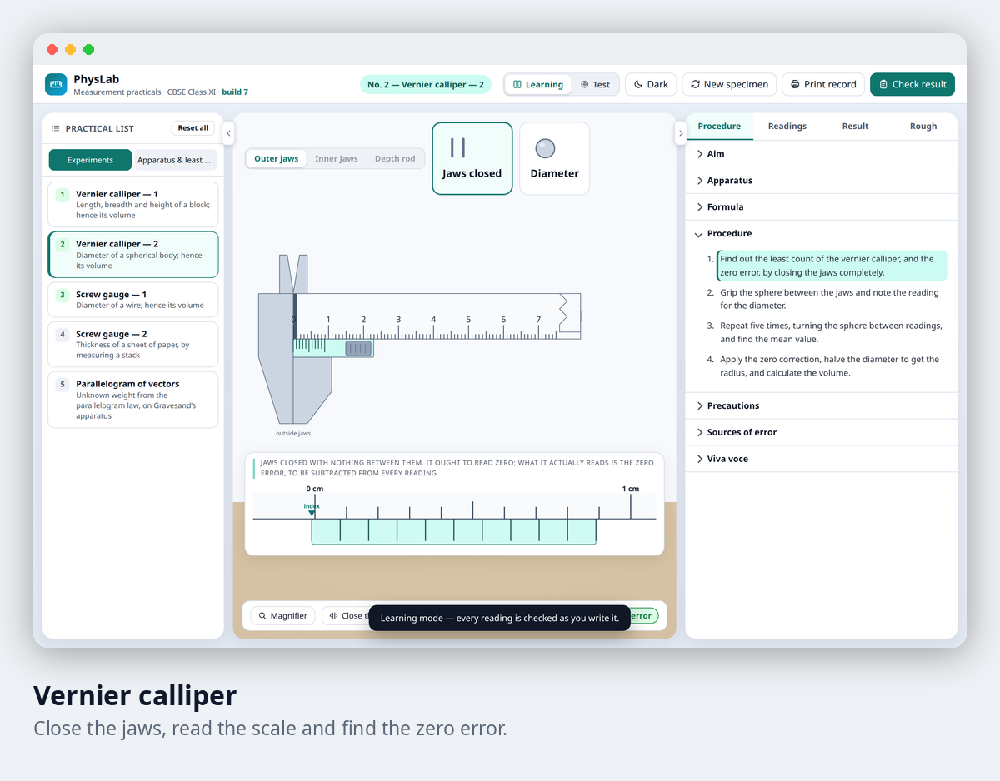
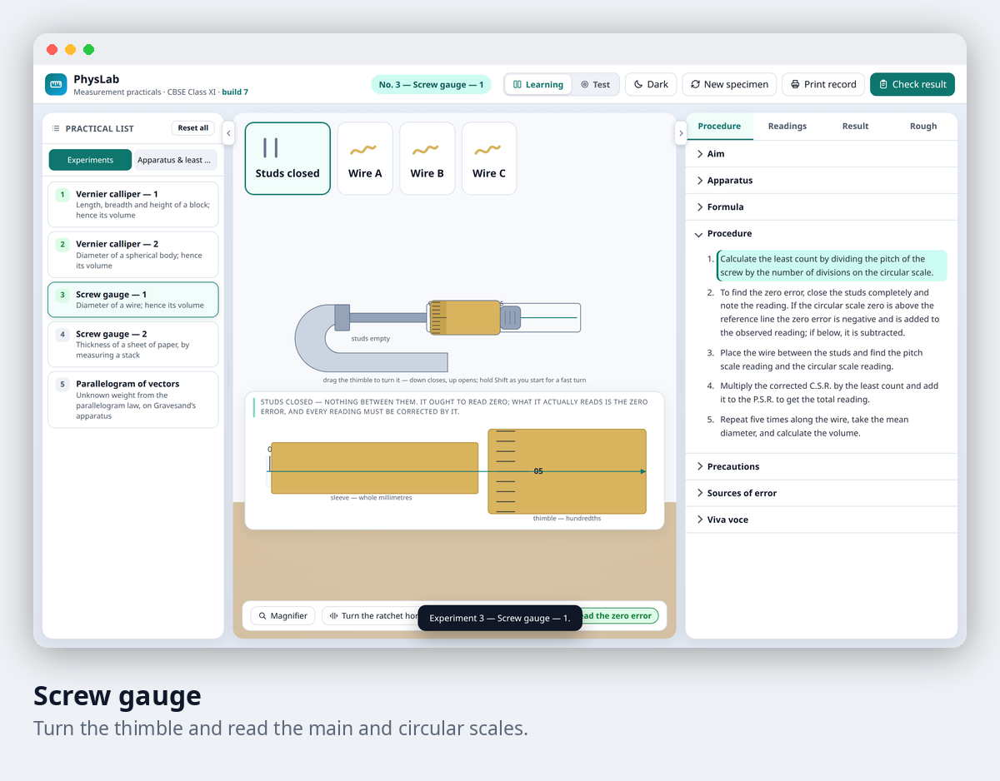
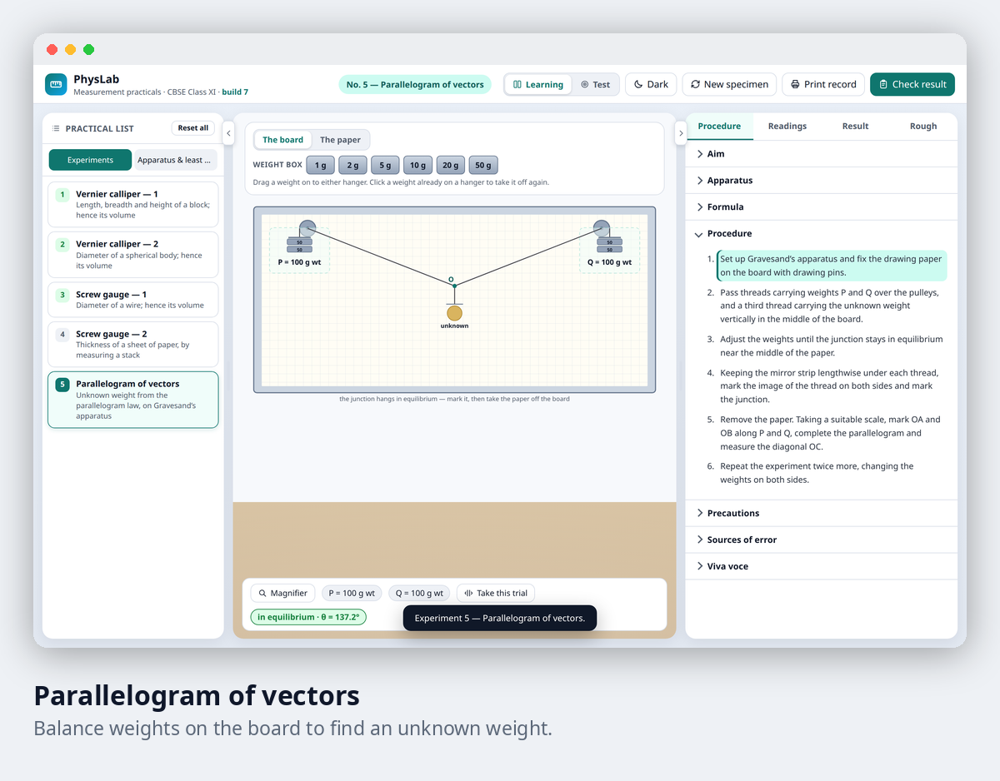

# Physics Lab Simulator

**Measurement practicals for CBSE Class XI physics, on one page.**

Practise the real practical list on screen. Close the jaws of a vernier calliper, turn a screw gauge, balance weights on a board, and take your readings the way you would in the lab.

| | |
|---|---|
| **Experiments** | 5 |
| **Modes** | Learning (every reading is checked as you write it) and Test (checked at the end) |
| **Runs in** | Any web browser, with nothing to install |
| **Extras** | Magnifier, dark theme, new specimen, printable record |

## The experiments

| # | Experiment | What you measure |
|---|---|---|
| 1 | Vernier calliper, part 1 | Length, breadth and height of a block, and so its volume |
| 2 | Vernier calliper, part 2 | The diameter of a sphere, and so its volume |
| 3 | Screw gauge, part 1 | The diameter of a wire |
| 4 | Screw gauge, part 2 | The thickness of a sheet of paper, by measuring a stack |
| 5 | Parallelogram of vectors | An unknown weight, using the parallelogram law |

Each experiment comes with the aim, apparatus, formula, procedure, precautions, sources of error and viva questions that a practical record needs.

## A look inside

<table>
<tr>
<td width="50%"></td>
<td width="50%"></td>
</tr>
</table>

## Learning mode and Test mode

| Mode | What happens |
|---|---|
| Learning | Every reading is checked against the instrument the moment you type it, and the working is laid out line by line, with the reason behind each step. |
| Test | The instrument and the procedure stay, but nothing is checked as you go. You take your readings, give your result, and see your percentage error at the end. |

## Who it is for

Class XI students preparing for their physics practicals, and teachers who want a way for students to practise reading instruments before lab day.

## Status

| | |
|---|---|
| Project | Active |
| Source code | Private |
| This repository | Overview only, with no code |

## Credits

Made by [@Shashanksaraswat123939](https://github.com/Shashanksaraswat123939).

## Rights

This page is a public overview of a private project. It contains no source code and does not describe how the project is built.

All rights reserved. You are welcome to read this page and share the link. You may not copy, reproduce or recreate the project from this material, and you may not use it to train, prompt or instruct automated systems to produce a copy. See the [LICENSE](LICENSE) file.
